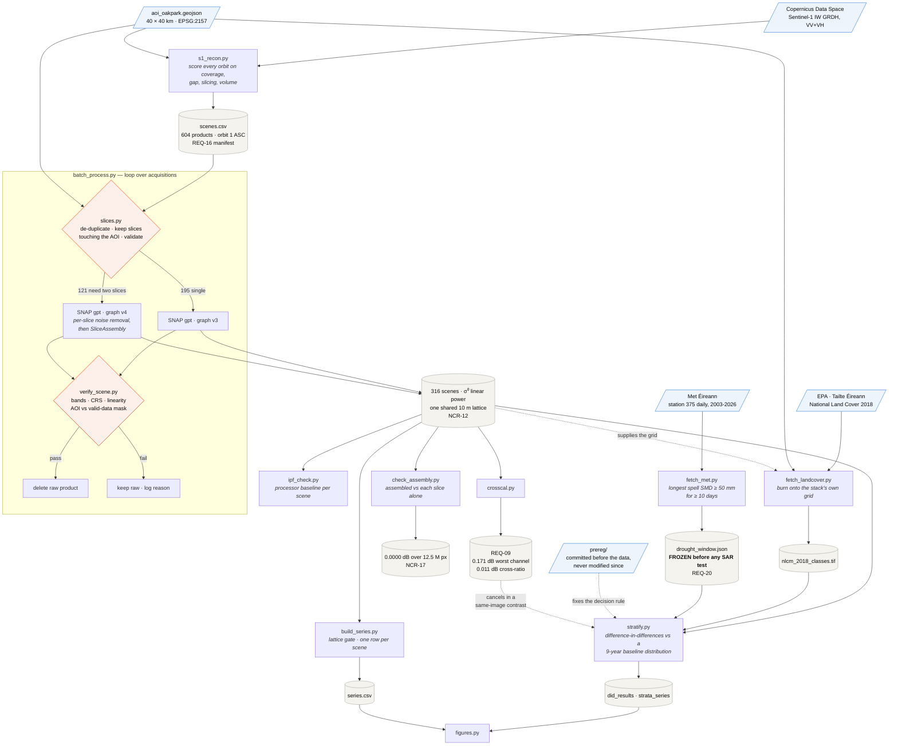

# Sentinel-1 SAR drought analysis — Co. Carlow, Ireland

Can C-band radar see a drought in Irish grassland? **No** — and the interesting
part is that an earlier version of this analysis said yes, at p = 0.04, and this
repository contains the test that refuted it.

316 Sentinel-1 acquisitions, eleven years, four satellites, one frozen orbital
configuration, 405 automated tests, and a pre-registration committed before the
data existed.

**Status:** complete. Both treatment years tested and refuted. See
[`TECHNICAL_REPORT.md`](TECHNICAL_REPORT.md).

---

## What happened

Ireland had an exceptional drought in summer 2026 — the second most severe in
the 23-year soil-moisture record at Oak Park, with Teagasc measuring grass
production 412 kg DM/ha below the five-year average.

A stratified analysis of 2021–2026 found a null. A later window-restricted test
then produced **p = 0.0398**: grassland senescence apparently doubling during
the meteorologically-defined drought window.

That result was not published. Instead the hypothesis, the test, the baseline
membership rule and the decision thresholds were written down and committed to
this repository, and the archive was extended back to 2016 to test it on data
that had not generated it — using **2018**, the most severe drought in the
record.

Both treatment years failed:

| | pre-specified test | result |
|:--|:--|:--|
| **2018** | steeper than baseline **and** z ≤ −2.306 | **z = +1.35** — flatter, wrong direction |
| **2026** | same test, nine-year baseline | **z = −1.75**, p = 0.119, inside |

2026's slope estimate did not change by a thousandth of a decibel between the
two runs. Only the baseline it was compared against changed.

## Why the earlier result looked real

The original analysis used five baseline years and reported a between-year
standard deviation of **zero**, treating it as evidence of a stable pipeline.

It was not. With five groups, the DerSimonian–Laird estimator returns zero
whenever within-year sampling error accounts for the observed scatter, and the
prediction interval then collapses toward the treatment year's own standard
error. Nine years put genuine between-year variation at **±0.17 dB/month** —
three times the treatment year's own fit error — and the effect disappears.

| baseline set | k | τ | z | p | |
|:--|---:|---:|---:|---:|:--|
| **9 years (pre-specified)** | 9 | 0.169 | −1.74 | 0.119 | inside |
| 8, dropping 2020 | 8 | 0.058 | −2.71 | 0.030 | outside |
| 5, the original 2021–2025 | 5 | **0.000** | −2.99 | 0.040 | outside |

The whole result rested on one year. 2020's slope is **+0.454 dB/month** where
most years are negative; the original five-year baseline happened to exclude it.

**The transferable finding: a small-sample variance estimate of zero is a
warning that the baseline is too small, not a finding about the instrument.**

## What stands

| | |
|:--|:--|
| Inter-platform calibration | 0.171 dB worst channel; **0.011 dB** in the cross-ratio |
| Slice-assembly agreement | **0.0000 dB** over 12.5 M pixels |
| Lattice consistency | **316 / 316** scenes on one 10 m grid |
| Per-acquisition noise floor | 0.63 dB, whole-AOI |
| Measured interannual variation | **±0.17 dB/month** (9 baseline years) |

A secondary finding with wider application: **a control works by being similar,
not by being inert.** A dry-versus-wet grassland contrast is twice as precise as
grassland-versus-forest on a thirtieth of the pixels.

## Documents

| | |
|:--|:--|
| [`TECHNICAL_REPORT.md`](TECHNICAL_REPORT.md) | The write-up — methods, results, the falsification, superseded claims |
| [`prereg/PREREGISTRATION_2018.md`](prereg/PREREGISTRATION_2018.md) | Hypothesis and decision rule, committed before the data existed |
| [Amendment 1](prereg/PREREGISTRATION_2018_AMENDMENT_1.md) · [Amendment 2](prereg/PREREGISTRATION_2018_AMENDMENT_2.md) | Two dated changes, both made while blind, each stating what would overturn it |
| [`METHODS_LOG.md`](METHODS_LOG.md) | Why the method changed nine times, with every superseded result preserved |
| [`PROJECT_PLAN.md`](PROJECT_PLAN.md) | Requirements, frozen configuration, risk register, 19-entry nonconformance log |

**The pre-registration's value is in the commit history.** Every decision in the
confirmatory test is dated earlier than the data that answered it, and anyone
who clones this repository can check that.

The three pre-registration files are deliberately **not merged into one**.
Each was committed once, on a different date, and none has been modified since
— `git log --diff-filter=A -- prereg/` shows 12, 13 and 15 October, and
`git log -p --follow` shows the only later commit touching them is an empty
rename. Merging them would produce a single file with a single recent commit,
reading as though it had been written in one sitting, which is exactly the
artefact pre-registration exists to rule out. Amendment 1 *withdrew* a
prediction and Amendment 2 *declares that an aggregate was seen and nothing
changed after* — neither statement means anything except as a separate dated
document. This is the one place in the repository where the file boundaries
are load-bearing evidence rather than organisation.

## Reproducing from a clean clone

```bash
git clone <repo> && cd SAR_Project/S1_Recon
python -m venv .venv && .venv/Scripts/activate   # Windows
python -m pip install -r requirements.txt
python -m pytest -q                               # 405 tests
```

Credentials for the Copernicus Data Space Ecosystem go in the environment, never
on the command line — it lands in shell history:

```powershell
$cred = Get-Credential -Message 'CDSE login'
$cred | Export-Clixml "$env:USERPROFILE\.cdse.xml"
```

SNAP 14 must be installed and `gpt` on the path. Expect ~760 GB of download and
~170 GB of retained output for the full eleven-year archive.

## The pipeline



**Four things in that diagram are the design, not plumbing.**

*The slice planner is a gate, not a filter.* 121 of 316 acquisitions need two
GRD slices assembled because the AOI straddles a packaging boundary throughout
2016–2020. It de-duplicates the catalogue (166 redundant products), keeps only
slices touching the AOI, and refuses to assemble anything non-contiguous.
Without it, every acquisition in 2018, 2019 and 2020 is unusable — which is to
say, the confirmatory test does not exist.

*Raw products are deleted only after verification passes.* A scene that fails
the gate keeps its 1.7 GB download and logs why, so a bad batch can be diagnosed
rather than re-fetched.

*Land-cover polygons are burned onto the stack's own pixel grid*, not onto a
grid of their own. Pixel *n* in the class raster is the same patch of Carlow as
pixel *n* in all 316 scenes, with no resampling anywhere. That only works
because every scene shares one lattice — see NCR-12 for what it cost to learn.

*The drought window is frozen before `stratify.py` can read it.* It comes from
rainfall and evapotranspiration, which know nothing about radar, and is written
with its rule and a timestamp. For the confirmatory year it was committed
**before the imagery was downloaded**.

## The scripts, in order

| script | does | output |
|:--|:--|:--|
| `s1_recon.py` | Scores every orbit on coverage, gaps, slicing and volume | `recon_out/scenes.csv` |
| `slices.py` | Single, assemble or exclude, per date — with de-duplication | (planning) |
| `batch_process.py` | Download → SNAP `gpt` → verify → delete raw, resumable | `C:/sar/proc/*.dim` |
| `verify_scene.py` | Per-scene gate: bands, CRS, AOI against the **valid-data mask**, linearity | exit 0/1 |
| `check_assembly.py` | Assembled scene against each of its slices processed alone | pass/fail |
| `ipf_check.py` | Processor baseline per scene, read from `.dim` headers | `ipf_versions.csv` |
| `crosscal.py` | Inter-platform offsets from consecutive-day pairs (REQ-09) | `results/phase1/` |
| `fetch_landcover.py` | NLCM polygons, burned onto the stack's own pixel grid | `data/landcover/` |
| `build_series.py` | 316 scenes → one row per acquisition, lattice gate | `results/phase2/series.csv` |
| `fetch_met.py` | Met Éireann daily data; derives and **freezes** the drought window | `results/phase4/` |
| `stratify.py` | Stratified difference-in-differences against a baseline distribution | `results/phase3/` |
| `figures.py` | Report figures, recomputed from the CSVs | `results/figures/` |

## Four decisions worth knowing before reading the code

**σ⁰ is stored and averaged in linear power, never dB.** The mean of a logarithm
is not the logarithm of a mean, and the error is systematic. A test in
`test_build_series.py` demonstrates it on this data's shape: −12.6 dB averaged
correctly, −15.0 dB averaged in dB. REQ-06.

**`alignToStandardGrid=true`.** With it false, every acquisition lands on its own
10 m lattice and no two rasters stack without resampling. Invisible to per-scene
checks; fatal to a time series. NCR-12.

**Any analysis window must come from data independent of the SAR**, be written to
the repository with its rule and a timestamp, and be frozen before the test runs.
REQ-20.

**A between-year variance of zero is a warning, not a result.** With fewer than
about ten groups, a random-effects estimator returns zero whenever sampling
error explains the scatter, and the prediction interval collapses toward the
treatment year's own error. NCR-18 — and the reason this repository contains a
refutation rather than a discovery.

## Data and licences

Copernicus Sentinel-1 2016–2026, processed by ESA, retrieved from the
[Copernicus Data Space Ecosystem](https://dataspace.copernicus.eu/).
National Land Cover Map of Ireland 2018 © Tailte Éireann and the Environmental
Protection Agency, CC BY 4.0. Daily climate data © Met Éireann, CC BY 4.0.
Grass production figures from Teagasc PastureBase Ireland.

Raw Sentinel-1 products are not committed (REQ-16). `recon_out/scenes.csv` is
the manifest and is sufficient to re-download the archive — it is kept in version
history because the CDSE catalogue is not static.
